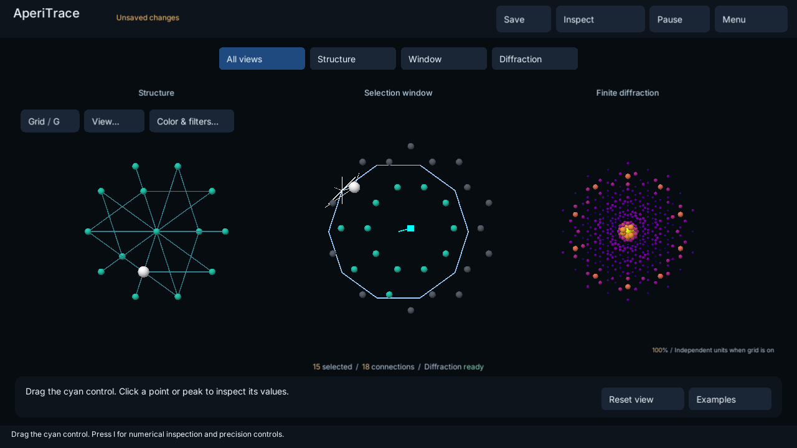

# AperiTrace

Event-resolved membership analysis and finite diffraction for cut-and-project models.
AperiTrace is implemented as the Python package `qc5d`, with an optional Unity
application for Windows and Quest 3.



*Windows app: linked structure, selection window, and calculated finite diffraction.*

Track the same five-integer lattice identity through physical space, an internal
selection window, and finite diffraction. Audit a path for membership intervals
that uniform sampling missed, export a recovered state, and recompute it from
the canonical tuples and direct finite sums.

## Install

Python 3.11 or later is required. Clone the repository and create an environment:

```sh
git clone https://github.com/MyunginLee/AperiTrace.git
cd AperiTrace
python -m venv .venv
```

On Windows:

```powershell
.venv/Scripts/python.exe -m pip install ".[dev]"
.venv/Scripts/python.exe -m pytest -q
```

On Linux or macOS, use `.venv/bin/python` instead. These instructions do not
constitute a macOS validation claim. Dependency ranges are in `pyproject.toml`;
`requirements-lock.txt` retains the original paper benchmark environment.

## Recover a missed interval

In the commands below, `python` means `.venv/Scripts/python.exe` on Windows
or `.venv/bin/python` on Linux/macOS, unless that environment is already active:

```sh
python -m qc5d.recover_interval --output changed-path
python -m qc5d.exploration --recompute changed-path/inside.json
python scripts/audit_targeted_resampling.py --output coverage.json
```

The bundled edited path misses two fully interior membership intervals with
33 uniform queries. One targeted midpoint query captures both. This canonical
example is not a real-material result or a guarantee of every diffraction
extremum. See [the worked example](docs/PATH_RECOVERY_EXAMPLE.txt).

For interactive Python inspection:

```sh
python -m qc5d.linked_viewer --export inspected-state.json
```

Click a point to focus its exact identity, use Left/Right to change the path
parameter, and E to export. A display-capable Matplotlib backend is needed
only for the interactive viewer. Use new output paths; exports do not overwrite.

## Reproduce the paper

```sh
python scripts/reproduce.py --output reproduction
```

This runs tests, both worked examples, direct state recomputation, the twelve-case
sampling summary, retained timing reanalysis, and figure/table regeneration.
It requires no Unity installation, headset, or TeX engine. Original CPU timings
are reanalysed, not relabelled as new measurements. See
[reproduction instructions](docs/REPRODUCIBILITY.md) for independent benchmark runs
and fresh benchmark measurements. The manuscript is not included in this repository.

## Windows and Quest application

Open `unity/XRSuperspace` in Unity 6000.3.10f1 using the pinned package files.
The scene is `Assets/XRSuperspace/Scenes/SuperspaceDemo.unity`.
See [app controls and build instructions](docs/APP.md).
Python provides event-resolved path analysis; Unity provides linked sampled-state
visualization. Display filters and colormaps do not change scientific results.
Coordinates are dimensionless model units, not calibrated material measurements.

## Repository contents

| Directory | Purpose |
| --- | --- |
| `src/qc5d` | Python library and command-line tools |
| `tests`, `configs`, `schemas` | Tests, frozen fixture, configuration and formats |
| `examples` | Executable examples and reference exports |
| `publication_data` | Retained scientific data and original figure captures |
| `scripts`, `experiments` | Reproduction, plotting and numerical experiment code |
| `unity/XRSuperspace` | Windows/Quest app sources, assets and pinned settings |
| `docs` | Scientific conventions, reproduction and app documentation |

## Scientific scope

The bundled model is a finite canonical 3+2 decagonal construction with unit
scattering weights and angular wavevectors. Exact IDs, counts, masks and integrity
checks are distinct from tolerance-bounded floating-point recomputation.
`clear_float64` is not an exact-real certificate. See
[scientific workflow](docs/SOFTWAREX_WORKFLOW.md) and
[portability contract](docs/PORTABILITY.md).

## Citation and license

Author: Myungin Lee, College of Computer, Mathematical, and Natural Sciences,
University of Maryland, College Park, MD, USA.
Support: [myungin@umd.edu](mailto:myungin@umd.edu).
Citation metadata: [CITATION.cff](CITATION.cff).
Original code and canonical data: [MIT](LICENSE).
Third-party licenses remain in force; see [notices](THIRD_PARTY_NOTICES.md).

<!-- PUBLIC_LINKS:BEGIN -->
- Repository: [MyunginLee/AperiTrace](https://github.com/MyunginLee/AperiTrace)
- Documentation: [user and reproduction guides](https://github.com/MyunginLee/AperiTrace/tree/main/docs)
<!-- PUBLIC_LINKS:END -->
